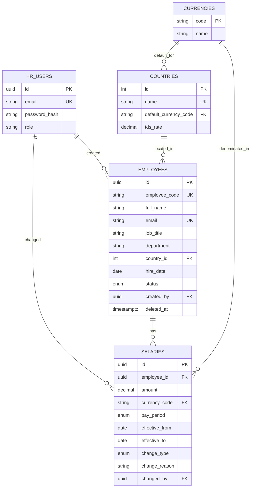

# Architecture — ACME Salary Management

## Goal

Web app for an HR Manager to manage ~10,000 employees’ salaries across countries: CRUD, versioned pay changes, simple TDS net-pay, and currency-safe analytics.

**Stack:** React + Vite + TypeScript + Tailwind · Node/Express + TypeScript · PostgreSQL + Prisma · JWT

---

## Key Design Decisions

### 1. Salaries are versioned rows

Salary is **not** a single field on the employee. Overwriting would erase history (e.g. ₹50k → ₹65k).

| Rule | Implementation |
| ---- | -------------- |
| Many salaries over time | Rows in `salaries` |
| Exactly one **current** salary | `effective_to IS NULL` + partial unique index |
| History | Prior rows in the same table |

We **do not** keep a separate `SALARY_HISTORY` table — that would duplicate the same facts.

**Raise flow (one transaction):** close current row → insert new current row.

### 2. Currencies are first-class

`CURRENCIES` (ISO 4217) is referenced by countries (default) and by each salary row. A salary may use a different currency than the country default. Analytics **never** average across currencies (or across monthly vs annual pay).

### 3. Integrity lives in the database

App logic is not enough. PostgreSQL enforces:

- `amount > 0`
- `effective_to >= effective_from` (when set)
- One current salary per employee (partial unique index)
- No overlapping date ranges (exclusion constraint on `daterange`)
- `status`, `pay_period`, `change_type` as enums

### 4. Soft delete and clear ownership

- Employees: `deleted_at` (history preserved)
- `employees.created_by` → HR user
- `salaries.changed_by` → HR user

### 5. Monolith is enough at 10k

10k rows is trivial for Postgres. We optimize with **indexes + pagination + SQL aggregates**, not microservices or caching layers.

---

## Data Model



**Indexes (essentials):** `employees(country_id)`, `employees(job_title)`, `salaries(employee_id, effective_from)`, partial unique on current salary.

---

## System Shape

```text
React (Vite)  --JWT-->  Express API  -->  Prisma  -->  PostgreSQL
                         routes → services → DB
```

- **Routes:** auth + Zod validation  
- **Services:** TDS, salary close-and-insert, analytics  
- **TDS:** India 20% · US 30% · other 0% → `net = gross − (gross × rate)` on **current** salary  

---

## API (summary)

| Area | Endpoints |
| ---- | --------- |
| Auth | `POST /auth/login` |
| Employees | `GET/POST /employees`, `GET/PATCH/DELETE /employees/:id` |
| Salaries | `POST /employees/:id/salary`, `GET /employees/:id/salaries` |
| Analytics | `GET /analytics/by-country`, `GET /analytics/by-job-title` |
| Lookups | `GET /countries`, `GET /currencies` |

---

## Deliberately Out of Scope

| Deferred | Why |
| -------- | --- |
| Multi-role RBAC | Single HR persona for MVP |
| Payroll / bank payouts | Not required to prove HR salary workflows |
| FX conversion | Avoid misleading cross-currency averages |
| Encryption + read-access audit | Production hardening; documented as follow-up |

---

## How We’ll Prove It Works

- Unit tests: TDS rules  
- Integration tests: salary transition + constraint failures; analytics don’t mix currencies  
- Seed: 10,000 employees  
- Deployed app + short demo video  
